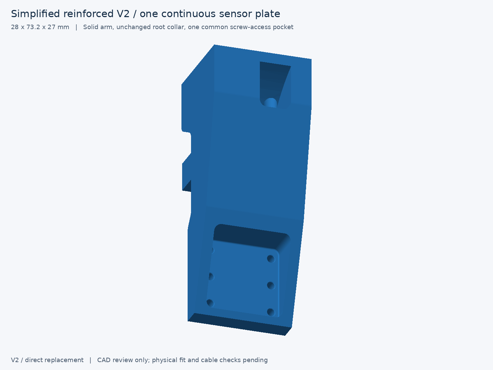

# PiPER–PaXini V2 — simplified reinforced replacement finger

The existing V2 is now a predominantly solid, one-piece finger with **one common rounded rectangular sensor-screw pocket and one continuous planar seating plate**. Six individual access recesses and separate pads are replaced; no cylindrical sensor bosses remain. The enclosed arm core is filled, and the existing cable saddle uses a single circular section instead of a segmented loft. CAD faces decrease from **226 to 120**.



The outside dimensions remain **28 × 73.2 × 27 mm**, with **70 mm functional tactile reach**. The root collar, 6 mm root screw seats, PiPER interface, sensor pose and cable route are preserved. Existing 5 mm web bands and 3.5 mm skin bands are retained within the solid arm. The exact root comparison is unchanged; measured arm sections preserve or increase area and bending moments. These are geometry checks, not a PETG strength rating.

The common pocket is **22 × 21.7 mm, R2**, open behind a **3.6 mm** screw-bearing plate. The shallow underside electronics clearance leaves **3.0 mm** central plate thickness. Six Ø2.1 holes retain only a 0.15 mm bore-mouth chamfer; **counterbore depth is zero**. Candidate **M1.6×5** screws, head Ø3 × 1.6 with 1.5 mm hex, give **1.4 mm nominal penetration** into the specified 2 mm sensor threads. The 17.5 × 8 mm sensor pattern is unchanged.

All six reference screw insertion, seating, tightening and removal paths pass with the finger attached. Minimum free screw clearance is **0.1414 mm** at the under-head blend; driver radial clearance is **0.75 mm**, or **0.60 mm** in the stated undersize sensitivity. Actual hardware, usable threads, torque and printed fit remain **UNVERIFIED**. [Per-screw evidence](docs/sensor-screw-access.md).

Remaining functional openings are the common sensor pocket and six bores, shallow electronics clearance, root screw/head access and service opening, central linkage clearance, rear cable channel and two strain-relief tie slots. No enclosed arm lightening cavity remains. The existing external cable loop and plug envelope are retained; physical plug-latch clearance remains unresolved in the supplied references.

| Deliverable | File |
| --- | --- |
| Main print STL, quantity 2 | [replacement_finger_print.stl](cad/exported/replacement_finger_print.stl) |
| Editable solid exchange | [replacement_finger.step](cad/exported/replacement_finger.step) |
| Native placement STL | [replacement_finger.stl](cad/exported/replacement_finger.stl) |
| Full gripper CAD at 0 / 50 / 100 mm | [closed](cad/exported/assembly_open0.glb), [midstroke](cad/exported/assembly_open50.glb), [open](cad/exported/assembly_open100.glb) |
| Sensor/carrier/finger pair | [pair STEP](cad/exported/finger_sensor_pair_open50.step) |
| Screw and driver paths | [access STEP](cad/exported/sensor_screw_access.step), [full assembly GLB](cad/exported/sensor_screw_access.glb) |
| CAD / PETG acceptance | [acceptance table](docs/printability-acceptance.md), [assembly results](docs/validation.json), [section comparison](docs/mechanical-comparison.md) |

Exactly five final previews are generated: [part](drawings/replacement_finger.png), [sensor mount and cross-section](drawings/sensor_mount.png), [closed/open assembly](drawings/assembly.png), [cable routing](drawings/cable_routing.png), [print orientation](drawings/print_orientation.png). Earlier previews and complete previous V2 are preserved in [the 74-file snapshot](revisions/before-geometry-simplification), verified by [its manifest](docs/pre-simplification-revision.json). All earlier snapshots, V1 and vendor assets remain unchanged.

**CAD VALIDATED for reference geometry; slicing NOT VERIFIED; not print-ready.** The side-down print STL has a 27 × 73.2 mm footprint and 28 mm height. It keeps longitudinal material and dominant gripping-plane bending within layers through the root. PETG baseline: 0.4 mm nozzle, 0.20 mm layers, 4–5 walls, 25–35% infill. The common pocket's upper wall needs accessible support or a slicer-validated bridge; root openings and horizontal bores also need layer review. No compatible slicer is available, so support toolpaths, filament usage and print time are unavailable. The existing [PRINT-HOLD](../PRINT-HOLD.md) remains in force.

Regenerate from the project root with the existing environment:

```bash
PYTHONDONTWRITEBYTECODE=1 ~/workspace/envs/venv/gripper-cad/bin/python v2/scripts/cad/build_v2.py
```

The build exports CAD, generates only the five previews, measures sections, verifies all six fasteners, validates every printable mesh and runs both legacy validators read-only. Recheck exports with `v2/scripts/cad/validate_adapter.py`. Source: [model](cad/source/replacement_finger.py), [parameters](cad/source/v2_parameters.py), [reference fasteners](cad/source/sensor_fasteners.py). Import STL as mm; STEP is mm and GLB metres. See [interface frames](docs/interface-spec.md), [manufacturing notes](docs/manufacturing.md) and [physical checks](measurements/fit-checklist.md). No dependencies were installed, printing performed or gripper commands issued.
