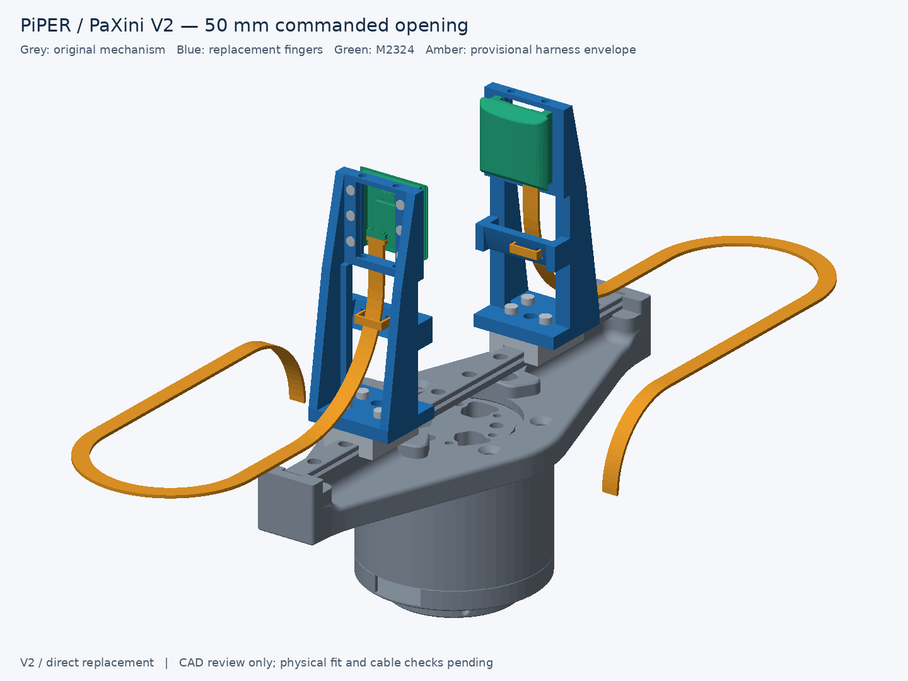

# PiPER–PaXini V2 — direct replacement fingers

Two identical, one-piece fingers bolt directly to the **retained original moving blocks**, using their four-hole 12 × 8 mm pattern. Each carries one **M2324** sensor on six rear screws. Stock fingers are removed whole and retained; the actuator and transmission remain unchanged.



V2 now preserves the original **70.000 mm functional reach**: the distal edge of the broad tactile crown is aligned with the stock fingertip, using the same mounting plane. The holder is **28 × 73.2 × 22.5 mm**, with a 4 mm flange, 4 mm sensor rails, two 3 mm rib webs with 5 × 3 mm lower flanges, and an open curved cross brace. Conservative sensor-envelope gaps are **1.995 / 51.995 / 101.995 mm** at commands 0 / 50 / 100. Objects below roughly 2 mm cannot be grasped with this nominal offset.

| Distance along the finger from the original mounting plane | Original PiPER | Corrected V2 |
| --- | ---: | ---: |
| Distal functional contact edge | 70.000 mm | 70.000 mm |
| Longitudinal contact region | 59.978–70.000 mm, distal flat pad | 51.155–70.000 mm, broad tactile crown |
| Holder/body distal edge | 70.000 mm | Holder 73.200 mm; sensor housing 72.395 mm |

The previous V2 broad tactile crown reached only 29.398 mm. This correction moves the actual sensing region to the tip; the original CAD is never scaled. [Common-datum side comparison](drawings/reach_comparison.png).

Both pre-existing clamp profiles, `m2324-reference` and `m2324-v2`, remain untouched as V1 history. All replacement-finger work is isolated here.

## Files and regeneration

Run from the repository root, using the existing environment:

```bash
PYTHONDONTWRITEBYTECODE=1 ~/workspace/envs/venv/gripper-cad/bin/python v2/scripts/cad/build_v2.py
# Recheck existing exports without regenerating them:
PYTHONDONTWRITEBYTECODE=1 ~/workspace/envs/venv/gripper-cad/bin/python v2/scripts/cad/validate_adapter.py
```

Edit [parameters](cad/source/v2_parameters.py), then regenerate; [replacement_finger.py](cad/source/replacement_finger.py) contains the model. The build exports, renders and validates V2, runs both legacy validators read-only, and checks all 232 pre-existing files plus the user-supplied goal-02 against their recorded hashes. No dependencies were installed; the existing `requirements.lock` applies.

| Artifact | Path under `v2/` |
| --- | --- |
| Main printed part, quantity **2** | [`cad/exported/replacement_finger_print.stl`](cad/exported/replacement_finger_print.stl) |
| Editable solid exchange | [`cad/exported/replacement_finger.step`](cad/exported/replacement_finger.step) |
| Jaw-local STL, for CAD comparison | `cad/exported/replacement_finger.stl` |
| Complete gripper assemblies | [`assembly_open0.glb`](cad/exported/assembly_open0.glb), [`assembly_open50.glb`](cad/exported/assembly_open50.glb), [`assembly_open100.glb`](cad/exported/assembly_open100.glb) |
| Finger/sensor/carrier pair STEP | [`cad/exported/finger_sensor_pair_open50.step`](cad/exported/finger_sensor_pair_open50.step) |
| Cable clearance solids | [`cad/exported/cable_routing_open50.step`](cad/exported/cable_routing_open50.step); all full GLBs include the cable route; `assembly_open50_cable_study.glb` is a compatibility copy |
| Small fit artifacts | `cad/exported/mount_fit_gauge{,_print}.stl`, `mount_fit_gauge.step`, `fastener_coupon{,_print}.stl`, `fastener_coupon.step` |
| Verification | [`docs/validation.json`](docs/validation.json), [`docs/build-manifest.json`](docs/build-manifest.json), [`docs/reference-measurements.json`](docs/reference-measurements.json) |

**Units:** STEP/parameters are mm; import STL at **1 unit = 1 mm**. GLB is metres and includes the complete original actuator. The STEP pair contains fingers, sensors and faceted retained carriers; it excludes the mesh-only actuator.

## Verified geometry and remaining assumptions

Both carrier patterns and all six sensor axes were recovered independently from the supplied geometry. The manual identifies M1.6 sensor holes with 2 mm depth. **Physical finger removability, carrier M2 thread/pitch and usable depth remain unverified.** See [interface evidence and coordinate frames](docs/interface-spec.md) and [validation results](docs/validation-report.md).

The sensor STEP confirms a connector exit **parallel to the module, toward the base**. The corrected route provides **12 mm straight clearance before an R38 mm centreline sweep**. An open saddle and removable tie restrain the leads away from the connector. A broad external service loop has R25.7 and R25 mm centreline turns and approximately **291 mm total centreline length per side**, constant through the full 50 mm travel of each jaw.

Amber geometry is a clearance study: a catalog-derived **6.5 × 1.4 × 1.35 mm exposed DF53 plug** and an assumed **5.2 × 1.0 mm loose-lead bundle**. The paired proximal port direction is CAD-derived; actual harness dimensions, selected IN/OUT port and manufacturer minimum bend radius remain unverified. The holder and screws clear an 8 mm straight unplug corridor, but the full rectangular plug envelope clips the vendor sensor housing during withdrawal; the actual stepped plug and latch must be checked. Hirose requires slack and no forced bend near the connector but supplies no numeric bend limit in the references inspected. [Source evidence](docs/references.md).

The loops require space: at full opening the complete cable envelope extends approximately **X = ±57.6 mm, Y = ±138.3 mm** in the gripper-base frame. Their fixed endpoints at **(±55, 0, 44.682) mm** assume suitable external loom restraints; the actual attachment must be checked. The modeled route clears the unchanged actuator, fingers and hardware, but is not a dynamic cable or fatigue test. See [rear routing](drawings/cable_routing.png), [side exit](drawings/cable_exit_side.png) and [service loops](drawings/service_loops.png).

## Hardware, assembly and printing

Candidate pair hardware: **8 × M2×6** root screws, **12 × M1.6×4** sensor screws, two M2324 modules and removable cable ties. Nominal penetration is 2.0 mm into the carrier and 1.4 mm into the sensor, without washers. Confirm real threads, heads, engagement and bottoming; no torque rating is established.

Assembly order: verify the interface, retain the removed stock fingers, attach replacements, install sensors, mate plugs straight along the module, then fit loose protective sleeving and releasable ties at the saddles. Lower root screws need a slim driver within the Ø2.4 mm access path. Sensor screws enter from the rear. For sensor removal, release its tie, withdraw the plug parallel to the module, remove six rear screws and lift the module toward the grasping gap; the root attachment and actuator stay assembled.

The `_print.stl` puts the **X = −14 mm side on the bed**, with a **22.5 × 73.2 mm footprint and 28 mm height**. Use removable support beneath the opposite beam and window spans; the open bays provide access for support removal. Inspect horizontal holes, pockets and tie slots in Bambu Studio. Candidate P2S settings: 0.4 mm nozzle, 0.2 mm layers, six walls, 50% infill and dry PETG. These are untested process choices; no load or deflection rating is claimed. The part fits the official [P2S build envelope](https://store.bblcdn.com/s7/default/2d1a01cd2dca425eb071ccc28c26c9fa/spec.pdf).

**Full printing and operation remain on hold under [PRINT-HOLD.md](../PRINT-HOLD.md).** New V2 gauges/coupons are digital fit proposals; the approved-file list is unchanged. Complete [physical measurements](measurements/fit-checklist.md) for mounting, screws, plugs/cable travel, print compensation and required load before release. No slicing, physical tests or gripper commands were performed.

Further previews: [opposed sensors](drawings/opposed_sensors.png), [exploded assembly](drawings/exploded.png), [root interface](drawings/mounting_interface.png), [sensor mounting](drawings/sensor_mount.png), [cable routing](drawings/cable_routing.png), [print orientation](drawings/print_orientation.png).
