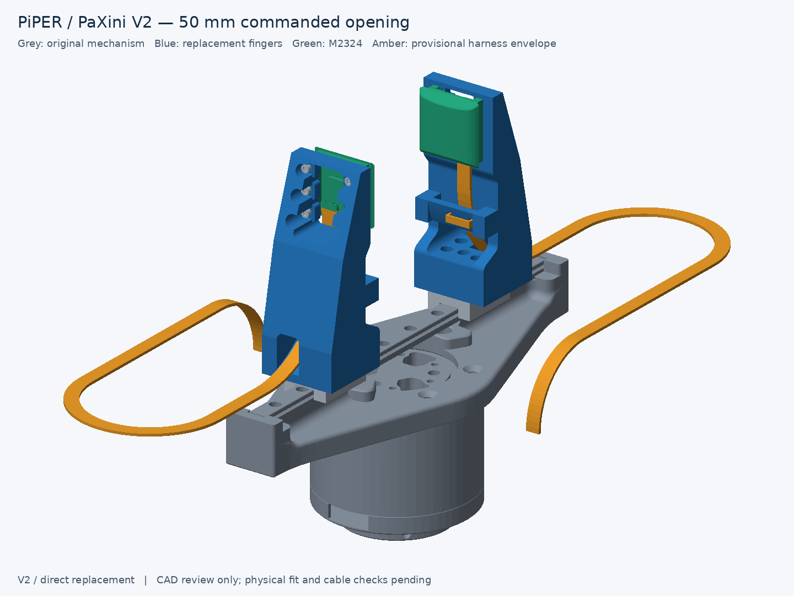

# PiPER–PaXini V2 — direct replacement fingers

Two identical, one-piece fingers bolt directly to the **retained original moving blocks**, using their four-hole 12 × 8 mm pattern. Each carries one **M2324** sensor on six rear screws. Stock fingers are removed whole and retained; the actuator and transmission remain unchanged.



The reinforced V2 preserves the original **70.000 mm functional reach** and opposed sensing faces. It is **28 × 73.2 × 27 mm**, with 5 mm main webs, 3.5 mm skins forming a partial box, a 6 mm root bearing seat, rounded transitions and short 6 × 6 mm sensor mounting flanges. Necessary sensor, cable and root-tool openings remain. Conservative sensor-envelope gaps are **1.995 / 51.995 / 101.995 mm** at commands 0 / 50 / 100.

The matched ideal-beam comparison evaluates the reinforced and earlier solids under identical assumptions. It does not predict printed stiffness or filament use for the **4–5 walls / 25–35% infill** baseline. Actual strength, stiffness and fatigue life remain unverified. See the [comparison table and assumptions](docs/mechanical-comparison.md), [CAD comparison](drawings/v2_structural_comparison.png), and [actual cross-sections](drawings/structural_sections.png).

| Distance along the finger from the original mounting plane | Original PiPER | Corrected V2 |
| --- | ---: | ---: |
| Distal functional contact edge | 70.000 mm | 70.000 mm |
| Longitudinal contact region | 59.978–70.000 mm, distal flat pad | 51.155–70.000 mm, broad tactile crown |
| Holder/body distal edge | 70.000 mm | Holder 73.200 mm; sensor housing 72.395 mm |

The early goal-01 V2 reached only 29.398 mm; goal-02 corrected this to 70 mm, which this reinforcement preserves. [Original PiPER versus current reach](drawings/reach_comparison.png).

Both pre-existing clamp profiles, `m2324-reference` and `m2324-v2`, remain untouched as V1 history. All replacement-finger work is isolated here.

## Files and regeneration

Run from the repository root, using the existing environment:

```bash
PYTHONDONTWRITEBYTECODE=1 ~/workspace/envs/venv/gripper-cad/bin/python v2/scripts/cad/build_v2.py
# Recheck existing exports without regenerating them:
PYTHONDONTWRITEBYTECODE=1 ~/workspace/envs/venv/gripper-cad/bin/python v2/scripts/cad/validate_adapter.py
```

Edit [parameters](cad/source/v2_parameters.py), then regenerate; [replacement_finger.py](cad/source/replacement_finger.py) contains the model. The build exports, renders, compares actual sections and validates V2, then runs both legacy validators read-only. It protects 232 original files, user-supplied goals 02/03, and all **47 files of the previous V2** in [revisions/goal-02](revisions/goal-02). The snapshot matches commit `fe94d0548cd070a5a3ab135652aff9194e426492`; use its STEP for comparison, or that Git revision at the project root for historical regeneration. Archived scripts are not intended to run from their relocated snapshot directory. The reinforcement before the raised towers is preserved as **67 files** in [revisions/before-shallow-counterbores](revisions/before-shallow-counterbores), checked against [its manifest](docs/pre-counterbore-revision.json). The rejected long-passage revision is preserved as **68 files** in [revisions/before-short-sensor-pads](revisions/before-short-sensor-pads), checked against [its manifest](docs/pre-short-pad-revision.json). No dependencies were installed; the existing `requirements.lock` applies.

| Artifact | Path under `v2/` |
| --- | --- |
| Main printed part, quantity **2** | [`cad/exported/replacement_finger_print.stl`](cad/exported/replacement_finger_print.stl) |
| Editable solid exchange | [`cad/exported/replacement_finger.step`](cad/exported/replacement_finger.step) |
| Jaw-local STL, for CAD comparison | `cad/exported/replacement_finger.stl` |
| Complete gripper assemblies | [`assembly_open0.glb`](cad/exported/assembly_open0.glb), [`assembly_open50.glb`](cad/exported/assembly_open50.glb), [`assembly_open100.glb`](cad/exported/assembly_open100.glb) |
| Finger/sensor/carrier pair STEP | [`cad/exported/finger_sensor_pair_open50.step`](cad/exported/finger_sensor_pair_open50.step) |
| Cable clearance solids | [`cad/exported/cable_routing_open50.step`](cad/exported/cable_routing_open50.step); all full GLBs include the cable route; `assembly_open50_cable_study.glb` is a compatibility copy |
| Small fit artifacts | `cad/exported/mount_fit_gauge{,_print}.stl`, `mount_fit_gauge.step`, `fastener_coupon{,_print}.stl`, `fastener_coupon.step` |
| Verification | [`docs/validation.json`](docs/validation.json), [`docs/build-manifest.json`](docs/build-manifest.json), [`docs/reference-measurements.json`](docs/reference-measurements.json) |
| PETG / P2S acceptance | [`docs/printability-acceptance.md`](docs/printability-acceptance.md), [`machine evidence`](docs/printability-acceptance.json), [`CAD build-section screen`](drawings/printability_sections.png) |
| Mechanical comparison | [`docs/mechanical-comparison.md`](docs/mechanical-comparison.md), [`docs/mechanical-comparison.json`](docs/mechanical-comparison.json), [`docs/section-properties.csv`](docs/section-properties.csv) |

**Units:** STEP/parameters are mm; import STL at **1 unit = 1 mm**. GLB is metres and includes the complete original actuator. The STEP pair contains fingers, sensors and faceted retained carriers; it excludes the mesh-only actuator.

## Verified geometry and remaining assumptions

Both carrier patterns and all six sensor axes were recovered independently from the supplied geometry. The manual identifies M1.6 sensor holes with 2 mm depth. **Physical finger removability, carrier M2 thread/pitch and usable depth remain unverified.** See [interface evidence and coordinate frames](docs/interface-spec.md) and [validation results](docs/validation-report.md).

The sensor STEP confirms a connector exit **parallel to the module, toward the base**. The corrected route provides **12 mm straight clearance before an R38 mm centreline sweep**. An open saddle and removable tie restrain the leads away from the connector. A broad external service loop has R25.7 and R25 mm centreline turns and approximately **291 mm total centreline length per side**, constant through the full 50 mm travel of each jaw.

Amber geometry is a clearance study: a catalog-derived **6.5 × 1.4 × 1.35 mm exposed DF53 plug** and an assumed **5.2 × 1.0 mm loose-lead bundle**. The paired proximal port direction is CAD-derived; actual harness dimensions, selected IN/OUT port and manufacturer minimum bend radius remain unverified. The holder and screws clear an 8 mm straight unplug corridor, but the full rectangular plug envelope clips the vendor sensor housing during withdrawal; the actual stepped plug and latch must be checked. Hirose requires slack and no forced bend near the connector but supplies no numeric bend limit in the references inspected. [Source evidence](docs/references.md).

The loops require space: at full opening the complete cable envelope extends approximately **X = ±57.6 mm, Y = ±138.3 mm** in the gripper-base frame. Their fixed endpoints at **(±55, 0, 44.682) mm** assume suitable external loom restraints; the actual attachment must be checked. The modeled route clears the unchanged actuator, fingers and hardware, but is not a dynamic cable or fatigue test. See [rear routing](drawings/cable_routing.png), [accessible strain relief](drawings/cable_strain_relief.png), [side exit](drawings/cable_exit_side.png) and [service loops](drawings/service_loops.png).

## Hardware, assembly and printing

Candidate pair hardware: **8 × M2×8** root screws and **12 × M1.6×5** sensor screws. Every sensor head seats at **Z=12.8**, only **3.6 mm** behind the fixed sensor mounting plane Z=9.2. The previous 6.6 / 10.6 / 14.6 mm screw passages and all six tall cylindrical bosses are removed. Root engagement remains 2.0 mm. Sensor penetration is **1.4 mm** nominal, leaving **0.6 mm** to the specified 2 mm depth. Actual usable thread depth, screw dimensions and tightening torque remain unverified.

Six **6 × 6 mm rounded mounting flanges** have **Ø2.1 bores** and flat head seats, with no counterbores. Minimum pad lip thickness is **3.0 mm**; the effective clamped stack is **3.6 mm at all six**. Each **4.5 mm wide U pocket opens sideways into the sensor window**, giving access directly to the low head seat. Continuous outer rails remain **3 mm wide**, and ligaments between pockets remain **3.5 mm**. The main 5 mm webs, root collar and 6 mm root seat are unchanged. The rear skin now meets 3.5 mm normal thickness after the small internal printability correction documented below. One-piece construction remains feasible; no removable plate was needed.

The [six-screw audit](docs/sensor-screw-access.md) gives **PASS for S1–S6 reference insertion, seating, tightening, removal and open side access**, including both attached jaw assemblies. Driver radial clearance is **0.75 mm** nominal and **0.60 mm** in the stated PETG undersize case. Minimum free screw-to-finger clearance is **0.1414 mm** at the under-head blend. All six have **0.21 mm minimum nominal-depth margin** when screw-length tolerance and an assumed ±0.15 mm stack error are combined. Physical hardware and print fit remain **UNVERIFIED**. See the [old/new section comparing 14.6 with 3.6 mm](drawings/sensor_screw_seating.png), [open access paths](drawings/sensor_screw_access.png) and [complete assembly/tool CAD](cad/exported/sensor_screw_access.glb).

Assembly order: verify the interface, retain the removed stock fingers, attach replacements through the root service window using a short L-key, then install sensors and harness. The key has a checked 60° inward turn; long tool tunnels through the sensor rails have been removed. Sensor screws enter from the rear. For sensor removal, release the tie and plug, remove six rear screws and lift the module toward the grasping gap. The root and actuator stay assembled. [Tool-access view](drawings/root_service_access.png).

The `_print.stl` puts the **X = −14 mm side on the bed**, with a **27 × 73.2 mm footprint and 28 mm height**. The user evaluation baseline is **PETG, 0.4 mm nozzle, 0.20 mm layers, 4–5 walls and 25–35% infill**. The [printability acceptance audit](docs/printability-acceptance.md) checks every active STL for manifold topology and self-intersections. A 0.074 mm inward core-roof adjustment makes the rear skin truly **3.500 mm normal to its slope**; outer geometry and all interfaces remain fixed. Coupon identification lands increase from 1.0 to 1.6 mm, preserving its fit geometry. The [immediate prior geometry](docs/pre-printability-revision.json) is retained along with all earlier complete revisions.

**CAD VALIDATED for reference geometry; slicing NOT VERIFIED; not print-ready.** No compatible slicer was found. The [CAD build sections](drawings/printability_sections.png) flag three sensor-pad starts needing support and the core's nominal 11.926 mm gap requiring bridge review. Support removal, retained holes after slicing, filament use and print time remain unverified. The gauge and coupon orientations are documented in [manufacturing notes](docs/manufacturing.md).

**Full printing and operation remain on hold under [PRINT-HOLD.md](../PRINT-HOLD.md).** New V2 gauges/coupons are digital fit proposals; the approved-file list is unchanged. Complete [physical measurements](measurements/fit-checklist.md) for mounting, screws, plugs/cable travel, print compensation and required load before release. No slicing, physical tests or gripper commands were performed.

Further previews: [opposed sensors](drawings/opposed_sensors.png), [exploded assembly](drawings/exploded.png), [root interface](drawings/mounting_interface.png), [sensor mounting](drawings/sensor_mount.png), [cable routing](drawings/cable_routing.png), [print orientation](drawings/print_orientation.png).
