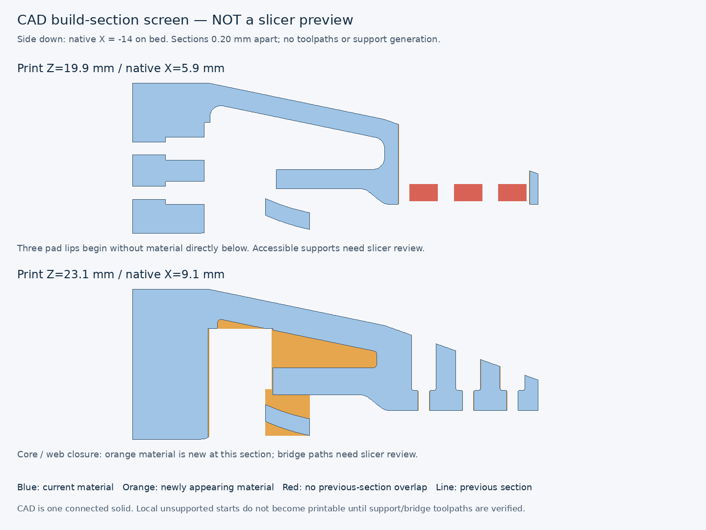

# V2 PETG / P2S acceptance — 2026-10-16

**CAD VALIDATED for the reference geometry. Not SLICE VERIFIED, not PHYSICALLY VALIDATED, not print-ready.**

Baseline: PETG, 0.4 mm nozzle, 0.20 mm layers, 4–5 walls, 25–35% infill. These are evaluation settings, not a tested process. [Machine evidence](printability-acceptance.json) records exact STL hashes and the build manifest; [assembly evidence](validation.json) and the [six-screw audit](sensor-screw-access.md) supply the CAD checks.

| Check | Result | Evidence |
| --- | --- | --- |
| Mesh integrity | **PASS** | All 6 current STLs: single closed manifold surface, consistent winding, no degenerate/duplicate faces or improper triangle intersections; exact file hashes recorded. |
| Minimum dimensions | **PASS** | Measured 3.500 mm normal skins, 5.000 mm main webs, 6.000 mm root seats. Sensor/service interface exceptions listed below; coupon identification lands increased to 1.6 mm. |
| Overhangs and bridging | **NOT VERIFIED** | No slicer. CAD flags three unsupported pad starts near build Z19.9 and a nominal core gap up to 11.926 mm; actual bridge paths remain unknown. |
| Support accessibility | **NOT VERIFIED** | Open sensor window provides potential access to pad supports. No generated support geometry or layer review; internal-core support removal is not established. |
| Mounting and sensor compatibility | **PASS** | Reference CAD: unchanged PiPER axes, 17.5 x 8 sensor pattern, sensor plane/reach and cable route; S1-S6 insertion/seat/tool/removal PASS. Actual hardware and plug latch fit remain unverified. |
| Structural orientation | **PASS** | Finger X=-14 side down: longitudinal Y and dominant Y-Z grip bending remain in the layer plane, including the root. No quantified printed strength claim; lateral/torsional loading is unvalidated. |
| PETG slicing | **NOT VERIFIED** | No compatible slicer executable/application found; no toolpath, filament/time estimate or slicer-native project. |

## Mesh evidence

Six active STL files = three printable components in native and print placements. Imported vendor meshes, assembly visualization meshes and historical revisions are not current printable exports. All six were checked individually, without mesh repair. Every edge has exactly two incident faces and every vertex has a single manifold fan. Finite coordinates, positive volume, consistent winding, single surface, duplicate and zero-area faces were checked. Triangle intersections were checked explicitly, including coplanar overlaps; legitimate common-edge/vertex contact is excluded. Numerical contact tolerance is 0.000001 mm; plane zero tolerance is 0.0000000001 mm. Nine analytic crossing/contact/separation cases passed. These are mesh checks, not a guarantee that slicing retains every hole.

| STL | Triangles | Connected surfaces | Improper intersections | Result |
| --- | ---: | ---: | ---: | --- |
| `fastener_coupon.stl` | 2904 | 1 | 0 | PASS |
| `fastener_coupon_print.stl` | 2904 | 1 | 0 | PASS |
| `mount_fit_gauge.stl` | 1712 | 1 | 0 | PASS |
| `mount_fit_gauge_print.stl` | 1712 | 1 | 0 | PASS |
| `replacement_finger.stl` | 25536 | 1 | 0 | PASS |
| `replacement_finger_print.stl` | 25536 | 1 | 0 | PASS |

## Dimensions and focused corrections

The rear skin measured **3.427783 mm normal to its slope** despite a 3.5 mm vertical setting. Moving only the inner core roof down **0.073738 mm** yields **3.500 mm normal thickness**, adding **40.319 mm³** and removing no finger material. Exact old/new booleans confine the addition to the existing core roof and R2 transitions. Outer geometry, root mounting, sensor alignment and cable route are fixed. Eight affected source/export files are preserved in [the immediate prior geometry snapshot](pre-printability-revision.json); all earlier complete snapshots and V1 are unchanged.

The CAD kernel returned an invalid direct cut between two STEP imports. That result is rejected. The accepted comparison uses the archived STEP against the parametric solid, plus valid cuts in both directions between the current STEP and its source showing **zero geometric difference**. Thickness is measured on the reimported STEP and meshes are independently checked; no numerical or printing clearance was added to bypass the comparison.

The front skin measures **3.500 mm**, main webs **5.000 mm**, and all four root bearing stacks **6.000 mm**. Coupon identification-notch spacing now leaves **1.600 mm** solid lands instead of 1 mm projections; its hole positions, diameters and 3.6 mm test stack are unchanged. The measured probes and their method are in the JSON.

The interface-specific exceptions are:

- 4.0 mm local side walls at the R3 root service opening preserve screw/key and cable access; the main webs stay 5 mm and all root bearing stacks stay 6 mm.
- Sensor interface: 3.6 mm stacks, 3.0 mm lips/outer rails, 3.50026 mm inter-pocket ligaments and 1.95 mm bore-edge ligaments. Short lips clear electronics and preserve direct screw access; intentional interface exception to main-web/skin dimensions.
- The existing distal sensor-window rim is 1.5 mm along Y. It preserves the sensor opening and holder tip boundary; outside the root/arm load path and not a screw-head bearing seat. Recorded interface exception to the 1.6 mm detail target.
- The 3 mm curved cable saddle and 1.6 x 3.6 mm tie slots retain the established cable clearance. Saddle dimension is vertical, not a new main-skin specification.
- The 0.15 mm bore-mouth chamfer and R0.4 pocket-floor transitions are interface reliefs, not isolated thin walls; both are retained for head seating. Coupon 1 mm identification cuts are voids; solid lands are now >=1.6 mm.

All six sensor seats remain Z=12.8 above the fixed Z=9.2 sensor plane: **3.6 mm pass-through**, no counterbore, candidate **M1.6×5, pitch 0.35, head Ø3 × 1.6, hex 1.5**. Nominal thread penetration is 1.4 mm into the specified maximum 2 mm depth. Reference driver clearance is **0.75 mm radial**, or **0.60 mm** under the stated 0.30 mm diametric undersize sensitivity. Actual screw/tool dimensions, full usable threads, print tolerance and torque remain UNVERIFIED for every screw. No new clearance compensation was added.

## Orientation and outstanding slicing evidence

- **replacement_finger:** Existing print STL: native X=-14 on bed; footprint 27 x 73.2, height 28. Dominant bending in layer plane.
- **mount_fit_gauge:** Native Y=-70 mating face on bed; footprint 28 x 22.5, height 6; all bores vertical. An unpowered fit gauge, not a load-bearing finger.
- **fastener_coupon:** Flat XY base on bed; 36 x 18, height 3.6; all fit holes and identification cuts vertical. An unpowered fit coupon.

The finger orientation keeps longitudinal material and dominant gripping-plane bending within layers through the root. It avoids placing the entire root in interlayer tension from the main bending load. Lateral/torsional loads and local joints still need physical validation. Existing fillets and load paths are retained; no infill-derived strength rating is assigned.

The selected 0.20 mm CAD sections expose three positive-X pad lips beginning near print Z=19.9 mm without overlap with the preceding section. They need support from the accessible central window or a validated toolpath strategy. Their native X-facing sides are candidate support-contact surfaces; the sensor plane, head seats and root datum must remain free of support contact. The main part is still one connected solid; these are local build-start risks, not disconnected STL bodies.

The core's nominal vertical gap reaches **11.926 mm**, above the conservative 10 mm bridge screen; R2 corners reduce closure spans, but actual bridge direction, anchoring and extrusion are not verified. The enclosed core communicates with the root service opening, but removal of generated internal support has not been demonstrated. Do not assume dense internal supports are removable. The open pockets, horizontal holes, tie slots, core closure and root require layer inspection. The flat gauge and coupon have vertical holes and no >45° downward faces above the bed in the mesh screen, but are also unsliced.

No compatible slicer was found in PATH or the application/workspace locations recorded in the JSON. **Slicer project, print time, filament usage, generated supports and retention of holes after slicing: NOT VERIFIED / unavailable.** CAD sections do not replace these results. The user baseline supersedes the earlier eight-wall/100% process suggestion. Solid-beam comparisons remain geometric comparisons; their mass and stiffness must not be presented as predictions for this sparse-infill baseline.

The [existing print hold](../../PRINT-HOLD.md) and [physical checklist](../measurements/fit-checklist.md) remain in force. No printing, physical assembly or powered motion was performed.
